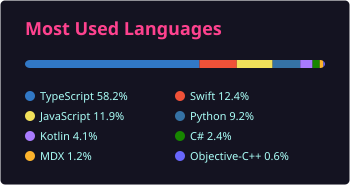

  

  
  
  
  
  

  

---

### 👨‍💻 About me

I've spent the last 7+ years building mobile apps with React Native and Expo, from camera- and media-heavy flows to subscriptions and custom native modules for when JavaScript alone can't do the job. I care a lot about developer experience: clean project structure, sensible defaults, and tooling that makes the next app faster to start.

- 🔭 Building React Native apps for clients, plus side projects for TV and desktop
- 🌱 Currently learning Node.js
- 📦 Maintaining two open-source npm packages
- 💬 Ask me about Expo native modules, on-device ML in React Native, or shipping to the App Store / Play Store

---

### 📦 Open-source packages

<table>
<tr>
<td width="50%" valign="top">

#### 🧍 [react-native-mediapipe-posedetection](https://github.com/EndLess728/react-native-mediapipe-posedetection)
Real-time pose detection in React Native using Google MediaPipe.

</td>
<td width="50%" valign="top">

#### 📲 [expo-check-installed-apps](https://github.com/EndLess728/expo-check-installed-apps)
Checks whether apps are installed, by package name on Android and URL scheme on iOS.

</td>
</tr>
</table>

### 🛠️ Side projects

<table>
<tr>
<td width="50%" valign="top">

#### 🚀 [react-native-expo-boilerplate](https://github.com/EndLess728/react-native-expo-boilerplate)
Production-ready Expo starter. Run `npx create-expo-boilerplate my-app` and pick your navigation, state and styling.

</td>
<td width="50%" valign="top">

#### 📄 [resume-builder](https://github.com/EndLess728/resume-builder)
Resume as code: write your CV in YAML and a GitHub Actions workflow builds the PDF, keeps it on Google Drive behind one link and pings you on Telegram.

</td>
</tr>
<tr>
<td width="50%" valign="top">

#### 📺 [MiTV-Remote](https://github.com/EndLess728/MiTV-Remote)
A remote for Xiaomi Mi TVs: Expo app for iOS/Android plus a macOS menu bar app.

</td>
<td width="50%" valign="top">

#### 📹 [TapoCam](https://github.com/EndLess728/TapoCam)
A Tapo camera viewer for Android TV, macOS and Windows.

</td>
</tr>
</table>

---

### 💻 Tech I work with

  
   
  
   
  

  
  
  
  
  
  
  
  
  
  
  
  
  
  
  
  

---

### 📊 GitHub stats

  
  

  <picture>
    <source media="(prefers-color-scheme: dark)" srcset="https://raw.githubusercontent.com/EndLess728/EndLess728/output/github-snake-dark.svg"/>
    <source media="(prefers-color-scheme: light)" srcset="https://raw.githubusercontent.com/EndLess728/EndLess728/output/github-snake.svg"/>
    
  </picture>

---

  If my packages save you some time, you can <a href="https://paypal.me/Monty728">buy me a coffee via PayPal</a> ☕

