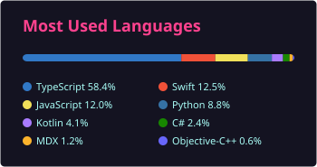

<h1 align="center">Hey, I'm Mantu 👋</h1>
<h3 align="center">Senior React Native & Expo developer · building mobile apps for 7+ years</h3>

  
  
  
  

---

I'm based in India and lead a React Native team. Most of my work is cross-platform apps with Expo: camera and media-heavy flows, subscriptions, native modules, and wiring up the native bits when JavaScript alone can't do the job. Lately I've been building team tooling too, like a shared Expo boilerplate and the standards around it.

- 🔭 Building React Native apps for clients, plus a few side projects for TV and desktop
- 📦 Maintaining two open-source npm packages (below)
- 🤝 Open to collaborating on React Native / Expo libraries and interesting app ideas
- 💬 Ask me about Expo native modules, on-device ML in React Native, or shipping to the App Store / Play Store

## 📦 Open-source packages

| Package | What it does |
| --- | --- |
| [**react-native-mediapipe-posedetection**](https://github.com/EndLess728/react-native-mediapipe-posedetection) | Real-time pose detection in React Native using Google MediaPipe |
| [**expo-check-installed-apps**](https://github.com/EndLess728/expo-check-installed-apps) | Checks whether apps are installed, by package name on Android and URL scheme on iOS |

## 🛠️ Side projects

| Project | What it is |
| --- | --- |
| [**MiTV-Remote**](https://github.com/EndLess728/MiTV-Remote) | A remote for Xiaomi Mi TVs: Expo app for iOS/Android plus a macOS menu bar app |
| [**TapoCam**](https://github.com/EndLess728/TapoCam) | A Tapo camera viewer for Android TV, macOS and Windows |
| [**React-Native-Expo-Boilterplate**](https://github.com/EndLess728/React-Native-Expo-Boilterplate) | The Expo starter my team builds new apps on |

## 💻 Tech I use

**Mobile**

  
  
  
  
  
  

**Languages & web**

  
  
  
  
  
  

**State & data**

  
  
  
  
  
  
  

**Tooling**

  
  
  
  
  
  

## 📊 GitHub stats

  
  

---

  If my packages save you some time, you can <a href="https://paypal.me/Monty728">buy me a coffee via PayPal</a> ☕

  

